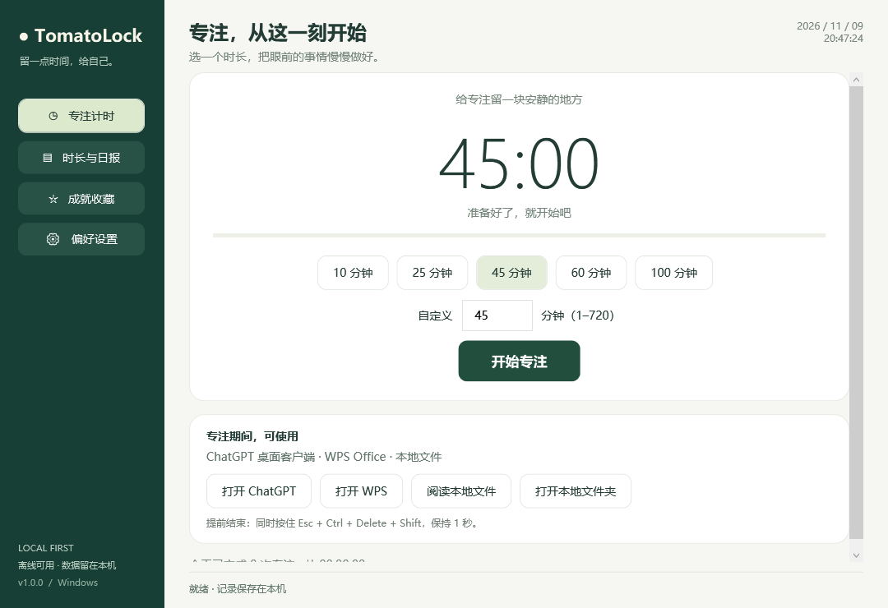

# TomatoLock 🍅

一个离线可用的 Windows 桌面番茄钟：把眼前的事情慢慢做好。

**v1.0.0 · Windows 10 1903+ / Windows 11，x64 · .NET Framework 4.8 · MIT**

## 下载与安装

- **[下载安装版 TomatoLock-Setup-1.0.0.exe](https://github.com/WhyCannotIHaveAName/TomatoLock/raw/refs/heads/main/releases/TomatoLock-Setup-1.0.0.exe)**
- **[下载免安装版 TomatoLock-Portable-1.0.0-win-x64.zip](https://github.com/WhyCannotIHaveAName/TomatoLock/raw/refs/heads/main/releases/TomatoLock-Portable-1.0.0-win-x64.zip)**
- [SHA-256 校验值](releases/SHA256SUMS.txt)

安装版安装到当前用户的 `%LocalAppData%\Programs\TomatoLock`，创建开始菜单入口，并支持在 Windows「已安装的应用」中卸载。无需管理员权限，**安装不会开启使用统计或开机自启**。卸载保留记录；删除统计可以在软件内操作。免安装版解压后双击 `TomatoLock.exe`，请同时保留旁边的 `.config` 文件。

安装包由仓库源码编译生成，没有捆绑或下载第三方安装器、浏览器扩展、服务或驱动。程序没有更新检查、联网 API、遥测或账户系统。尚未购买代码签名证书，因此安装包没有发布者签名；可核对校验值或自行编译。

现代 Windows 已包含所需的 .NET Framework 4.8。程序自身离线运行；ChatGPT / WPS 的联网能力取决于它们自己。



## 第一次使用

1. 打开已经安装的 ChatGPT 桌面客户端和 WPS。
2. 在 TomatoLock 的「偏好设置」点 **自动识别应用**，确认展示的程序路径。也可以手动选择 exe。WPS 文字、表格、演示、PDF 是不同的程序，需要相应的 `wps.exe`、`et.exe`、`wpp.exe`、`wpspdf.exe`。
3. 返回「专注计时」，选 10 / 25 / 45 / 60 / 100 分钟，或输入 1–720 的任意整数分钟。
4. 点「开始专注」，阅读本次限制说明并开始。结束后自动记录，播放提示音。
5. 提前结束时，**同时按住 Esc + Ctrl + Delete + Shift，保持 1 秒**。左右 Ctrl / Shift 均可，按下顺序不限，但四键必须有重叠按住的时间。这里没有 Alt。

程序会在开始前核对确认过的完整路径与 SHA-256 指纹。ChatGPT / WPS 更新后指纹或路径变化，需要在本次专注之外重新识别确认。配置文件位于当前用户数据目录，属于用户可编辑数据，不是防篡改的安全策略。

## 功能与边界

| 功能 | v1.0.0 的行为 |
|---|---|
| 原生离线 UI | WPF 界面、系统本地日期时钟、托盘、完成提示 |
| 自定义时间 | 10 / 25 / 45 / 60 / 100 分钟预设，1–720 整数分钟自定义 |
| 专注限制 | 每约 100 ms 检查前台窗口，拦截非允许窗口的键盘和鼠标输入，并尝试切回番茄钟；不会杀死其他应用或关闭未保存的文件 |
| 允许应用 | 用户事先确认的 ChatGPT / WPS 可执行文件；番茄钟自身及内置阅读器 |
| 本地文件 | 资源管理器本地磁盘文件夹；内置文本与图片只读阅读；Office / PDF 使用 WPS。启动本地 exe 不会因此获得通行权 |
| 四键解锁 | 全局键盘钩子检测四键重叠按住 1 秒。专注中 Esc 被保留，不会传给其他应用 |
| 持久化 | 每 5 秒原子写入 JSON，保留上一份备份；完成时立即保存。强杀 / 崩溃后恢复为中断，最多损失最近一个保存周期 |
| 计时可靠性 | 用系统单调的醒着时间计时，改系统时间不会增加专注时长；睡眠、休眠、锁屏不计入。超过 2.5 秒的处理停顿不补记 |
| 成就 | 首次完成、10 / 45 / 100 分钟单次目标、10 次、10 / 50 小时、连续 3 / 7 天，共 9 项 |
| 可选后台统计 | 默认关闭；只统计前台应用活跃时长。默认无输入超过 180 秒后停止计入，可设 30–3600 秒。阅读期间如果长时间没有输入，也会被统计为空闲；番茄计时不受空闲阈值影响 |
| 可选域名统计 | 需要单独同意；通过 Windows UI Automation 读取地址栏，约每 1.5 秒采样，保留域名与时长。失败单列「未识别网站」 |
| 开机自启 | 单独勾选并保存后，登记当前用户 Run 项；Windows 登录后启动并收起到托盘 |
| 每日日报 | 跨本地自然日自动生成 Markdown 与 CSV；关闭程序及完成专注时生成当前日报；下次启动补生成已有记录的历史日报。也可在「时长与日报」按日期导出 |

**这是应用级自律限制，不是 Windows kiosk、内核级沙箱或不可绕过的安全边界。** Windows 安全桌面、UAC、管理员权限、任务管理器的其他入口、强制结束进程、重启、不同桌面等不受保证。程序不修改系统安全策略，不禁用系统恢复入口。Win32 的前台切换、钩子超时和权限级别也可能影响拦截；快速切换有时间窗口，后台应用仍可运行和播放音视频。需要保证在任何情况下所有其他软件都完全不可用的场景，不适合用这一版。

本地资源管理器位置由隔离的子进程核查，限制 UNC、网络盘和虚拟「主页」等非本地位置。核查约每秒一次，有 1–3 秒的采样延迟；新打开的窗口可能需要等核查完成后再切回。桌面和任务栏允许作为应用导航表面。ChatGPT / WPS 自身的网页、插件、宏或联网功能不会被单独过滤。

内置文本支持 txt / md / csv / json / log / cs / cpp / h / py，按 UTF-8/BOM 解码，大小上限 5 MB；图片支持 png / jpg / jpeg / bmp / gif（静态首帧），上限 25 MB。Office / PDF 需要你已安装的 WPS，不包含第三方文档渲染器。

## 统计与隐私

- 统计、自启均默认关闭；软件尚未替你启用这些设置。
- 应用统计保存进程文件名、日期和累计秒数；允许列表另外保存你确认的程序路径与哈希。
- 网站统计保存域名，不保存完整 URL、路径、查询字符串、页面标题、搜索词或网页内容。**隐私 / 无痕窗口若暴露地址栏，也会被统计**；不希望记录时关闭网站统计。
- 适配 Chrome、Edge、Firefox 的常见地址栏标识，并尝试兼容 Brave、Vivaldi、Opera。浏览器版本、语言、辅助功能、权限和页面窗口结构可能让读取失败；不要把「未识别」当作没有使用网站。
- 地址栏采样存在约 1–3 秒的误差，切换标签时可能短暂归到上一个域名。只统计前台标签；不累计后台标签。
- 网站统计是浏览器应用时间的细分，**不能把两者相加**。
- 同一文件名的多个应用安装合并计数；不知道可执行路径的前台窗口不计入。
- 关闭窗口：专注中继续在托盘运行；开启统计时继续统计。右键托盘「退出」可在无专注时结束程序；专注中需先四键解锁。
- 数据仅在本机，路径为 `%LocalAppData%\TomatoLock`。`state.json` 是当前数据，`.bak` 是备份，`reports` 是日报。你可自行复制整个目录备份。
- 「删除应用 / 网站统计」会清空统计和生成的日报，并覆盖当前记录的备份；专注记录、成就保留。曾为损坏恢复而另行保留的 `.corrupt-*` 文件、你手动复制的文件不自动删除。
- 关机期间无法统计，也不会生成虚构数据。修改时区 / 本地日期会影响按日归档，但不增加完成时长。专注记录归于结束日，应用统计跨午夜拆分到实际日期。

## 构建与检查

无需 NuGet、npm 或下载 SDK。使用 Windows 自带的 .NET Framework C# 编译器：

```powershell
powershell -NoProfile -ExecutionPolicy Bypass -File .\build.ps1 -Test -Package
```

`-Test` 运行数据 / 计时 / 域名脱敏 / 午夜拆分 / 崩溃恢复 / 备份恢复 / 成就 / 四键状态检查，以及四个 WPF 页面的内存渲染检查和安装包载荷检查。`-Package` 生成 `releases/` 下的安装包、免安装 ZIP 和 SHA-256 清单。`build/` 与 `test-output/` 不提交。

测试时可使用独立目录：

```powershell
.\build\TomatoLock.exe --data-dir .\test-output\manual
```

这个模式会在目录里写入 `startup-ready.txt` 供启动检查。不要在未结束专注时更换数据目录；多个目录属于彼此独立的实例。

验证结果和待手动检查的项目见 [TESTING.md](TESTING.md)。本次已验证编译、26 项逻辑检查、4 个页面渲染、自定义时长显示、安装载荷以及实际窗口加载。**未声称在所有 Windows / 浏览器版本上完成实机兼容性测试，也未完成四键持续按住、跨应用限制、安装/卸载、自启和浏览器地址栏的端到端实测。**

## 源码结构

```text
src/Core.cs            数据、计时、成就、日报
src/Native.cs          Win32 输入拦截、允许列表、隔离地址栏读取
src/Main.xaml          原生桌面界面
src/MainController.cs  交互、生命周期、采样调度
src/Program.cs         启动、实例互斥、子进程入口
src/Setup.cs           当前用户安装 / 卸载
tests/                 可重复的逻辑与界面构建检查
```

实现直接使用微软 API，没有复制第三方番茄钟项目，也不依赖外部安装包。

参考文档：[LowLevelKeyboardProc](https://learn.microsoft.com/en-us/windows/win32/winmsg/lowlevelkeyboardproc)、[SetWindowsHookEx](https://learn.microsoft.com/en-us/windows/win32/api/winuser/nf-winuser-setwindowshookexw)、[Interrupt Time](https://learn.microsoft.com/en-us/windows/win32/sysinfo/interrupt-time)、[UI Automation](https://learn.microsoft.com/en-us/windows/win32/winauto/entry-uiauto-win32)、[.NET Framework 与 Windows](https://learn.microsoft.com/en-us/dotnet/framework/install/on-windows-10)。
A tomato clock locking your PC during your work time.
